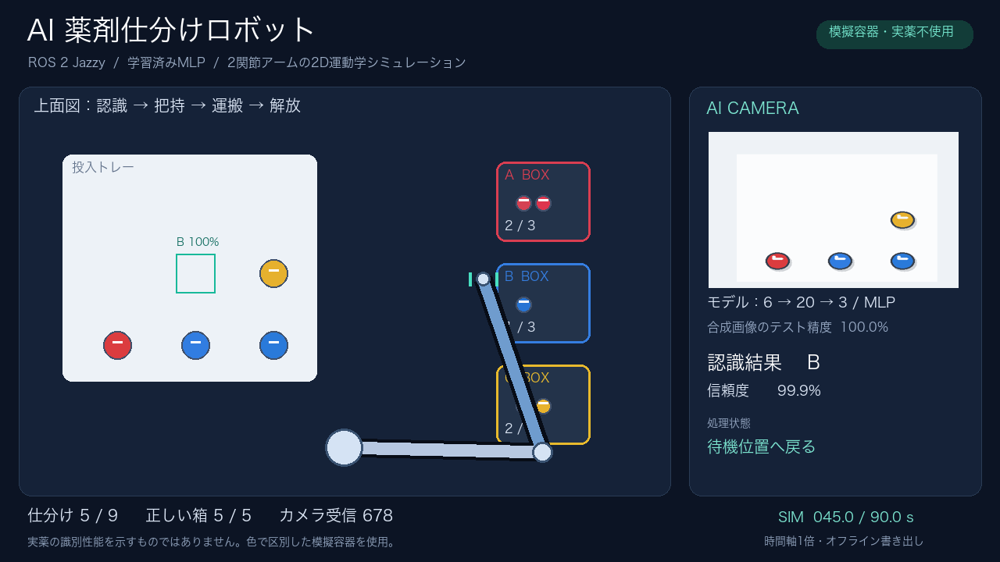
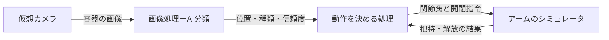
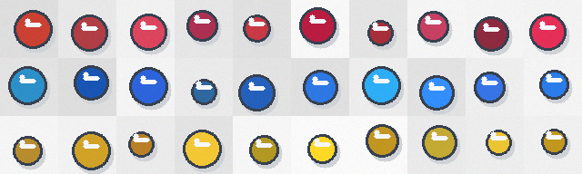

# AI薬剤仕分けロボット 🤖

**カメラ画像をAIで読み取り、模擬薬剤の容器をロボットアームで仕分ける、ROS 2の学習作品です。**

赤・青・黄の容器を画面の中に9個置き、AIがA・B・Cに分類します。
アームは認識した容器の位置へ移動し、つかんで、対応する箱へ運びます。
APIキーや有料AIサービスは使いません。



▶ **[90秒のデモ動画を見る](assets/demo.mp4)**

GitHub上で再生されない場合は、動画のページからダウンロードして再生してください。

> この作品は、上から見た**独自の2Dシミュレーション**です。
> カメラ画像もプログラムで生成しています。実機や実写カメラ、Gazeboは使用していません。
> 容器は色で区別した教材用のものです。実際の薬の種類・成分・用量は識別しません。

## 1. 何をする作品？

仕分ける対象は次の3種類です。

| 容器の見た目 | AIが選ぶ種類 | 運ぶ場所 |
|---|---|---|
| 赤 | A | Aの箱 |
| 青 | B | Bの箱 |
| 黄 | C | Cの箱 |

1. 仮想カメラが、トレー上の容器の画像を撮ります。
2. 画像処理で容器の場所を見つけます。
3. AIが、見つけた容器をA・B・Cのどれかに分類します。
4. ロボットが容器をつかみ、対応する箱へ運びます。
5. 正しい箱へ置けたか確認し、次の容器へ進みます。

AIの判断に合わせて、ロボットの行き先が変わることが、この作品の中心です。

## 2. AIとROS 2は何を担当するの？

| 言葉 | 初めて読む方向けの説明 | この作品での役割 |
|---|---|---|
| AI | 例を見て、分類のための数値を学習するプログラム | 容器をA・B・Cに分類する |
| ROS 2 | ロボット用の処理同士で情報をやり取りする仕組み | 画像・認識結果・動作指令をつなぐ |
| ノード | 役割を分けた処理の単位 | カメラ・認識・動作判断を担当する |
| トピック | ノードが情報を送受信する通り道 | カメラ画像や指令を運ぶ |
| シミュレータ | ロボットや物体の状態を計算し、画面に再現するプログラム | アームと容器の位置を更新する |
| Pixi | 必要なソフトとバージョンをそろえる道具 | ROS 2やPythonの環境を準備する |



AIは容器の正解ラベルを受け取りません。画像から取り出した特徴だけを読みます。
正解ラベルは、最後に「正しい箱へ入ったか」を確認する側だけが持っています。

## 3. 動かす準備

### 対応する環境

- **Intel製CPUのMac（macOS 14以降）**
- 最初の環境構築に使うインターネット接続と、数GB程度の空き容量
- macOS標準の日本語フォント

動作確認はIntel Mac・macOS 15.8.1で行いました。
Apple Silicon（M1/M2/M3など）・Windows・Linuxでは、この環境定義のままの動作は確認していません。
すでにROSを導入していても、この作品専用の環境を使う手順です。

### 手順A：Pixiを準備する

Macの「ターミナル」を開き、以下を1行ずつ実行します。
`#` から始まる行は説明用のコメントなので、実行結果には影響しません。

```bash
# Pixiの公式インストーラをダウンロードします。
curl -fsSL https://pixi.sh/install.sh -o /tmp/physical-ai-pixi-install.sh

# ダウンロードしたインストーラを実行します。
bash /tmp/physical-ai-pixi-install.sh
```

終わったらターミナルを一度閉じ、開き直してください。次のコマンドで確認できます。

```bash
# バージョンが表示されれば、Pixiの準備は完了です。
pixi --version
```

すでにPixiが使える場合、このインストールは不要です。
参考：[Pixi公式サイト](https://pixi.sh/) / [RoboStackの導入説明](https://robostack.github.io/GettingStarted.html)

### 手順B：この作品をダウンロードする

このGitHubページの **Code → Download ZIP** を選び、ZIPを解凍します。
ターミナルで `cd ` と入力し、**末尾に半角スペースを1つ付けてから**、解凍した作品フォルダをドラッグ＆ドロップし、Enterを押します。

次のコマンドで、現在のフォルダに `README.md` と `pixi.toml` があることを確認してください。

```bash
# 今いるフォルダのファイル一覧を表示します。
ls
```

Gitが使える方は、代わりに以下でも入手できます。

```bash
# GitHubから作品をコピーします。
git clone https://github.com/riri-chinen0301/Physical-AI-2026-1_-.git

# コピーした作品のフォルダへ移動します。
cd Physical-AI-2026-1_-
```

### 手順C：ROS 2などをまとめて用意する

作品フォルダ内で、次を実行します。

```bash
# 記録されたバージョンで、ROS 2と必要なライブラリを準備します。
pixi install --frozen
```

初回は多数のパッケージをダウンロードするため時間がかかります。
完了後は、同じフォルダで次の起動コマンドを実行できます。

## 4. 起動する

```bash
# 画面を表示し、実時間の進みに合わせて仕分けを行います。
pixi run demo
```

起動すると、AIを学習してから仕分けが始まります。最初の6秒は作品の説明を表示します。
容器9個の仕分けが終わると、完了画面を表示して終了します。
途中で止めるときは、ターミナルで **Control + C** を押してください。

Finderから操作する場合は、環境構築後に `Run.command` を開いても同じデモを実行できます。
実行権限が付いていない場合は、ターミナルの `pixi run demo` を使ってください。

### 画面の見方

- **左側**：投入トレー・ロボットアーム・分類先の箱
- **右上**：AIへ渡している仮想カメラ画像
- **認識結果**：現在扱っている容器のA・B・C分類
- **信頼度**：AIの出力スコア。実際に正しい確率を保証する値ではありません
- **処理状態**：把持位置へ移動、運搬、解放などの工程
- **下側**：仕分け数、正しい箱に入った数、画像の受信数

### 動画だけ作る

```bash
# ウィンドウを出さずに、同じ動作を計算して動画を書き出します。
pixi run export
```

生成物は作品フォルダに保存されます。再実行すると同名ファイルを上書きします。
最初から掲載している動画・結果は、別の `assets/` と `examples/` に保存してあります。

| 生成されるファイル | 内容 |
|---|---|
| `demo.mp4` | 90秒・1280×720・15fpsの動画 |
| `model.npz` | 学習したAIの数値（重み） |
| `training_metrics.json` | 学習とテストの結果 |
| `run_results.json` | 各容器の分類・行き先・仕分け結果 |
| `training_examples.png` | 学習画像の例 |
| `preview_*.png` | 動画内の代表的な場面 |

動画は90秒分の**シミュレーション時間を時間軸1倍で書き出したもの**です。
実時間の画面録画ではありません。倍速再生はせず、書き出し方式を動画内に表示しています。
`--realtime` を使っても処理が追いつかないと、実際の表示には90秒以上かかることがあります。

## 5. コードを読むなら、この順番がおすすめ

各Pythonファイルには、日本語の `#` コメントを書いています。
コメントは説明文であり、Pythonは計算の命令として実行しません。

| 順番 | ファイル | 何をしている？ |
|---|---|---|
| 1 | [`vision.py`](vision.py) | 画像を作る → AIを学習する → 容器を分類する |
| 2 | [`robot.py`](robot.py) | 手先の位置と、肩・肘の角度を計算する |
| 3 | [`main.py`](main.py) | カメラ・AI・アームをROS 2でつなぎ、画面と動画を作る |
| 4 | [`test_core.py`](test_core.py) | AI・位置推定・アーム計算の自動テスト |
| 設定 | [`pixi.toml`](pixi.toml) | 必要なソフトと、短い実行コマンドを定義する |
| 環境記録 | `pixi.lock` | 実際に使うパッケージのバージョンを固定する |
| レポート | [`report.md`](report.md) | 課題の目的・方法・結果・今後の課題を説明する |

例えば `robot.py` の次の処理は、「手先をどこへ動かすか」を「関節を何度曲げるか」へ変えています。

```python
# 容器の中心位置を指定して、肩と肘の角度を求めます。
pick = ik([self.target['x'], self.target['y']])

# AIが選んだ種類の箱へ届く、肩と肘の角度を求めます。
place = ik(BINS[self.target['label']])
```

この例は `main.py` の動作判断部分にあり、`robot.py` の `ik` 関数を呼んでいます。
`ik` は逆運動学（Inverse Kinematics）の略です。

### `main.py` の中をさらに分けると

| 処理 | 担当 |
|---|---|
| `World` | 容器を配置する、カメラ画像を作る、把持・解放を判定する |
| `Vision` | カメラ画像を受け取り、容器の位置・種類・信頼度を返す |
| `Controller` | どの容器を、どの箱へ、どの工程で運ぶか決める |
| `dashboard` | 作業台・アーム・説明・認識結果を画面へ描く |
| `main` | 全体を起動し、繰り返し実行して、結果を保存する |

3つのROSノードは、1つのPythonプロセス内で実行します。
画像・検出結果・動作指令の受け渡しには、実際のROSトピックを使っています。

## 6. AIはどう学習している？

学習には、明るさ・色・位置・サイズ・ノイズを変えた合成容器画像を使います。



1. 合成画像を3種類×500枚、合計1,500枚作ります。
2. 画像を混ぜ、1,200枚を学習用、300枚を評価用に分けます。
3. 容器部分から「RGBの平均3個＋標準偏差3個」の計6個の数字を取り出します。
4. 入力6個 → 隠れ層20個 → 出力3個のニューラルネット（MLP）を学習します。
5. 学習に使っていない300枚で分類結果を確認します。

「標準偏差」は色のばらつきを表す数字です。「隠れ層」は入力と答えの間で特徴を組み合わせる計算部分です。
学習中は予測と正解の差が小さくなるように、重みという数値を700回更新します。

**画像内の場所探しは従来の画像処理、A/B/Cの分類がAIの担当です。**
YOLOのような物体検出モデル全体を学習した作品ではありません。

## 7. 確認できた結果

| 確認内容 | 結果 |
|---|---|
| 学習に使わない合成画像300枚 | 300/300正解（100%） |
| デモ動画の仕分け | 9/9個が正しい箱へ到着 |
| 種類の並びを変えた実行（seed 13） | 9/9個が正しい箱へ到着 |
| 自動テスト | 4項目すべて成功 |
| 動画の読み込み確認 | 全1,350フレーム、90秒 |

詳細な記録は [`examples/`](examples/) にあります。
この分類精度は、同じ作り方の合成画像を使った評価です。実際の薬や実写画像に対する精度ではありません。

確認を自分で実行するには、以下を使います。

```bash
# AI・位置推定・空画像・アーム計算の4項目を確認します。
pixi run test

# 容器の種類の並びを変え、動画を作らずに仕分けを確認します。
pixi run check-layout

# AIの学習と評価だけを実行します。
pixi run train
```

`check-layout` の結果は `run_results_seed_13.json` に保存します。
このオプションは種類の並びを変えるもので、トレー内の配置座標は同じです。

## 8. よくあるつまずき

| 表示・状況 | 対応 |
|---|---|
| `pixi: command not found` | Pixi導入後にターミナルを開き直し、`pixi --version` を確認する |
| `pixi.toml` が見つからない | `ls` で確認し、解凍した作品フォルダへ `cd` で移動する |
| `No module named rclpy` | 普通の `python main.py` ではなく、`pixi run demo` で実行する |
| 初回の起動が遅い | 依存ライブラリの初回読み込みに時間がかかる場合があるため、ターミナルの出力を確認する |
| 日本語フォントのエラー | macOS標準フォントを使用するコードのため、対応するIntel Macで実行する |
| `H.264 video encoder unavailable` | 動画保存の機能が使えない環境。`pixi run python main.py --preview --no-video` で動作表示だけ試す |
| ROS通信がタイムアウトする | この作品を複数同時に起動せず、終了後に1つだけ起動する。通信制限のある実行環境も確認する |

## 9. 今できること・今後の課題

現在は、色で区別した模擬容器を、既知のトレー内から仕分ける教材用デモです。
信頼度85%未満の候補は選びませんが、未知の物体を確実に見分けて除外する機能はありません。

カメラは容器レイヤーだけを撮る簡略化モデルです。アームによる遮蔽、レンズの歪み、実写の照明差は省略しています。
画像とロボットは同じ平面座標を使い、容器の把持・配置を距離で判定します。
上下動、重力、把持力、衝突、容器の転倒を計算する物理エンジンは使用していません。

今後は、実写や形状・ラベルを含む画像認識、3D物理シミュレータ、衝突回避を伴うアーム制御へ発展させることが目標です。

## 参考資料

- [RoboStack：ROS環境の導入](https://robostack.github.io/GettingStarted.html)
- [ROS 2 rclpy：Python向けROS API](https://docs.ros.org/en/jazzy/p/rclpy/)
- [OpenCV：動画の書き出し](https://docs.opencv.org/4.x/dd/d9e/classcv_1_1VideoWriter.html)
